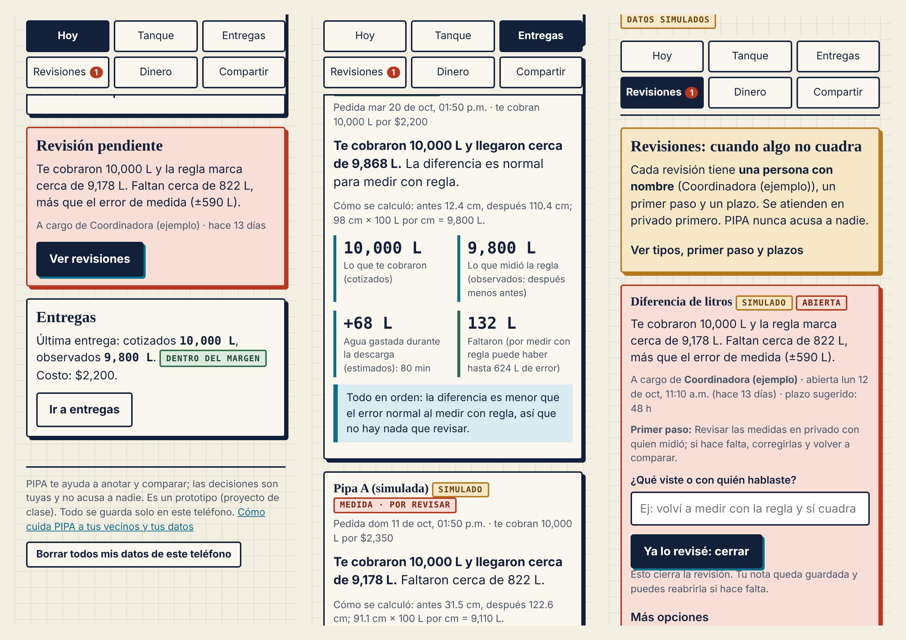
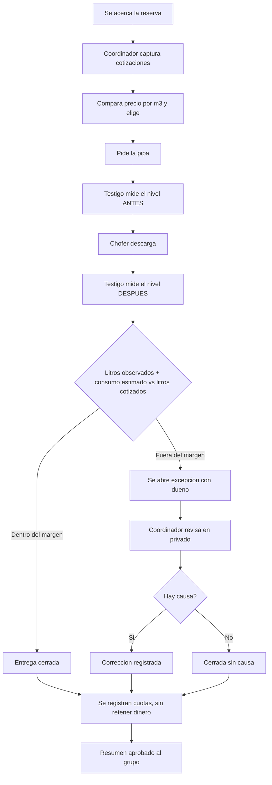
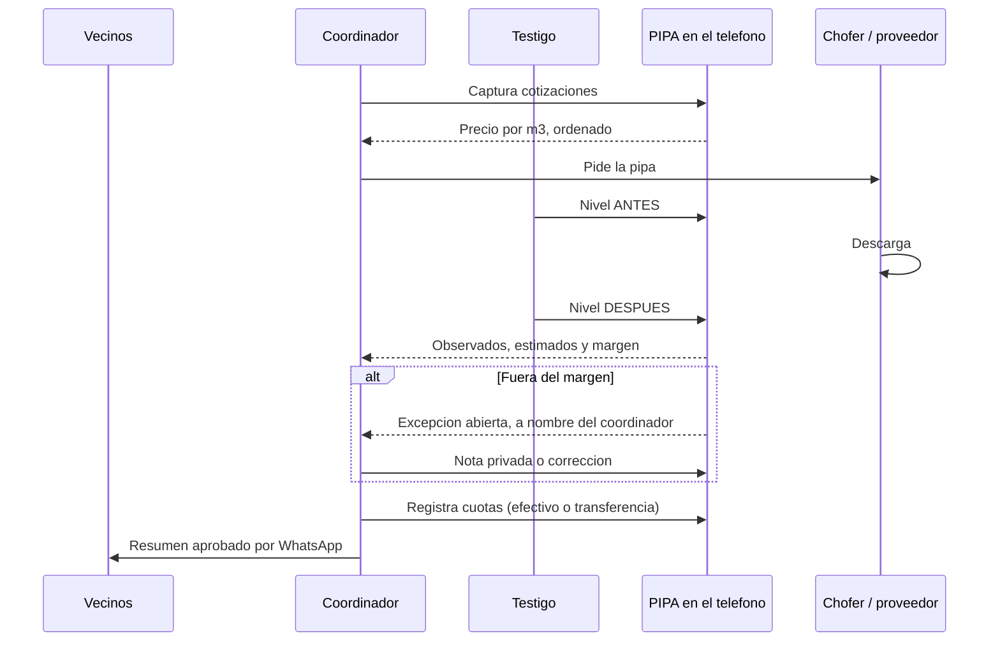

# PACKET: PIPA

*Semana 11 de AI 2041, capítulo 10 ("Dreaming of Plenitude"). Rol: OPERATOR. Individual, antes de escribir código.*

## 1. El problema, en mis palabras

Cuando en una cisterna compartida se acaba el agua, se pide una pipa. Ahí empieza el problema de información: **nadie tiene un registro propio de cuántos litros pidió, cuántos entraron y quién pagó qué.** El chofer dice una cantidad, el proveedor cobra una cantidad, y los vecinos pagan en efectivo o por transferencia sin comprobante. Si algo no cuadra, no hay con qué discutirlo.

El Blueprint del equipo eligió este vacío: **herramientas de agua del hogar, "pipa entre vecinos"**: lecturas calibradas del tanque, un registro de entregas que guardan los residentes y un libro de gastos acordado. Mi postura de Operator quedó registrada como disenso (prefería el registro de pepenadores), pero la parte que me toca aquí es otra: **que esto funcione el día 1 con una persona real, y que se sepa quién atiende cuando algo falla.**

## 2. El usuario exacto

**Usuario 1: el coordinador de una cisterna compartida.** Una persona con nombre (no "el comité") que ya hace esto a mano: pide la pipa, junta las cuotas y avisa por WhatsApp. Es un vecino, no un técnico. Tiene celular, poco tiempo y cero ganas de aprender una app nueva.

Quién más aparece:

- **Vecinos (hogares):** pagan una cuota. Algunos solo en efectivo y sin smartphone. Nunca se les niega el agua por no usar la app.
- **Testigo de la entrega:** un vecino que mide el nivel antes y después.
- **Chofer / proveedor:** externo. No usa la app y no recibe datos de nadie.

Como Operator, las tres preguntas que me tienen que salir:

1. **¿Quién es el usuario 1 el día 1?** Un coordinador que acepta el rol por su nombre. Sin coordinador nombrado, la app no abre excepciones (condición 4).
2. **¿Qué se rompe primero?** La medición: si el testigo no mide antes y después, no hay litros observados. Por eso es el paso con dueño explícito.
3. **¿Qué pasa con 100 usuarios?** Más cisternas, cada una con su coordinador. No hay base central: los datos viven en cada teléfono y solo sale un resumen aprobado.

## 3. Definición de éxito

> "Antes de que cierre el módulo, un coordinador puede registrar **una entrega completa** (litros cotizados, observados y estimados), ver que se abre una **excepción con dueño** cuando la diferencia pasa del margen, anotar las cuotas **sin retener dinero**, y compartir un **resumen aprobado** con el grupo, todo desde su celular y con datos inventados y etiquetados."

Cómo se comprueba: el selftest del motor (cálculos), el pase mecánico (Playwright contra el sitio en vivo) y la prueba de persona sintética.

## 4. Mockup

*(Hecho con HTML a partir de mi diseño, sin IA de imágenes. Muestra la pantalla "Hoy": nivel del tanque, aviso de pronóstico y la excepción abierta.)*

## 5. El flujo (Mermaid)

### 5.1 Una entrega, de principio a fin

### 5.2 Quién hace qué (swimlane)

## 6. La línea de comparación global

**Lo mejor que existe en la Tierra para esto es** el sistema de Chennai (India), donde la agencia de agua puso GPS a unos 300 camiones tanque contratados y los supervisa desde un centro de control para frenar viajes sin registro. Lo encontré en una nota de Geoawesomeness, sin fecha visible, que habla solo de rutas y de la agencia, no de cuánta agua se entrega ni de qué puede ver el residente.

**La mía cambia o se localiza en:** que el registro es **del residente** y mide **litros en el tanque** (antes y después) en vez de rutas del camión, en una cisterna compartida de la CDMX donde los canales existentes (Sacmex por teléfono, Locatel y empresas privadas de 5, 10, 20 y 44 mil litros, con precios de 1,200 a 3,000 pesos según una nota de UnoTV de marzo de 2022) no incluyen una forma de comprobar los litros recibidos.

*Lo que no encontré: ninguna fuente que verifique volumen entregado desde el lado del residente. Eso no prueba que no exista.*

## 7. Visión a 3 años (carta ligera)

Si esta rebanada funciona, PIPA es el **cuaderno compartido de una cisterna**: cada edificio o grupo de vecinos lleva su propio registro de lecturas, entregas y cuotas, y un grupo de cisternas puede, con permiso, compartir resúmenes agregados para que Sacmex o un proveedor vea el patrón sin ver a ningún hogar. Un proveedor que quiera competir podría publicar un registro de entregas verificado con testigos. Lo que no se vuelve nunca: un directorio de proveedores ni una calificación de personas.

## 8. Qué NO construyo

Cuentas y base de datos; integración con Sacmex, municipios o proveedores; directorio de proveedores; cobrar o retener dinero; calificaciones de vecinos o listas públicas de deudores; negar agua a alguien; sensores físicos reales (sensing es el celular más una alimentación simulada y etiquetada); pronóstico de llegada de la pipa; auditoría de contratos públicos (extensión posterior, con otros candados); campaña de concientización y app de consejos (zona prohibida).

## 9. Arquitectura y stack

| Capa | Qué | Por qué |
|---|---|---|
| App | Next.js 16 (App Router), React 19, TypeScript | Misma base que CENTÍMETRO; deploy gratis en Vercel |
| Datos | `localStorage` con try/catch | Condición 1: las lecturas crudas se quedan en el teléfono. Sin servidor que guarde nada |
| Sensing | Lectura manual del nivel (el celular como sensor) más una alimentación **simulada** de 21 días | Etiquetada en pantalla como simulada |
| ML | Regresión lineal (tendencia más fin de semana) con **backtest contra una línea base** (el promedio) | Condición 6: el modelo solo se muestra si le gana a la línea base; es asesor, no oráculo |
| Marketplace | Comparador de cotizaciones capturadas a mano más reparto de la cuota | Sin directorio de proveedores |
| Motor | Funciones puras con autoprueba | Las reglas calculan; no hay IA que opine sobre dinero ni litros |
| Seguridad | Sin llaves, sin cuentas, sin datos reales; todos los campos validan largo y tipo | Piso de seguridad |

## 10. Plan de pruebas

- **Mecánica:** autoprueba del motor (calibración, litros observados, margen, excepción, reparto, consumo diario, línea base, pronóstico, backtest) y Playwright contra el sitio en vivo: flujo completo, caso sin coordinador, caso sin historial, `localStorage` bloqueado, ancho de celular (390 px).
- **Persona sintética:** una coordinadora de 58 años, que usa WhatsApp, desconfía de las apps y se rinde en silencio. Se le pasan las capturas en orden; se registra cada confusión y se arregla la peor.
- **Condiciones del Blueprint:** una tabla en `/condiciones` que dice dónde se cumple cada una y qué se comprobó.
- **Condición para parar:** si el coordinador de la persona no logra registrar una entrega sin ayuda en dos rondas, se simplifica el flujo antes de agregar nada.
